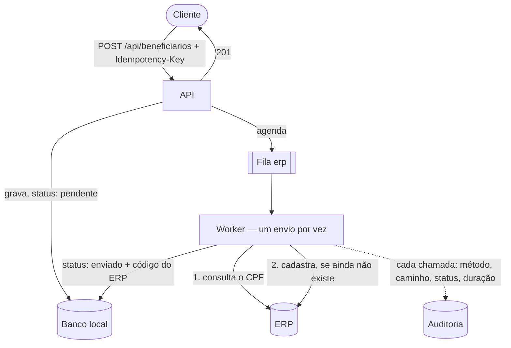

# Integração ERP resiliente

[](https://github.com/Canhao43/integracao-erp-resiliente/actions/workflows/ci.yml)

API em Laravel que cadastra beneficiários de plano de saúde e os envia a um ERP que **não colabora**: não tem chave única (reenviar duplica o registro), responde devagar, falha de vez em quando — às vezes **depois de gravar** — e tem token que expira e é revogado a cada login.

É o tipo de integração que eu mantenho no trabalho, com o TOTVS Protheus. Aqui o ERP é **simulado** e todo dado é fictício. O objetivo é mostrar, em código e em teste, como uma integração dessas sobrevive em produção.

> Construído com agentes de IA (Claude Code) e revisado por mim em cada PR. As regras que os agentes seguem estão em [`CLAUDE.md`](CLAUDE.md); cada decisão, com as alternativas descartadas e o teste que a prova, está no [registro de decisões](docs/decisoes/README.md).

## Roteiro

| Marco | O que entra | Estado |
|---|---|---|
| **M1** | API de cadastro, validação de CPF, Docker e CI | ✅ |
| **M2** | `Idempotency-Key`: o mesmo pedido reenviado não cadastra duas vezes | ✅ |
| **M3** | ERP simulado que falha de propósito; envio em fila, um por vez, com timeout e retry | ✅ |
| **M4** | Token do ERP em cache com renovação; auditoria das chamadas | ✅ |
| **M5** | Registro de decisões consolidado | ✅ |

## Como rodar

Precisa de Docker.

```bash
git clone https://github.com/Canhao43/integracao-erp-resiliente.git
cd integracao-erp-resiliente
docker compose up
```

Na primeira subida o container instala as dependências, cria o `.env`, gera a chave e roda as migrations. A API fica em `http://localhost:8080`.

Sobem cinco containers: `app` (PHP-FPM), `web` (Nginx), `db` (MySQL), `worker` (a fila de envio ao ERP) e `scheduler` (tarefas agendadas). Para ver o ERP falhando e a fila tentando de novo: `docker compose logs -f worker`.

Testes: `docker compose exec app php artisan test`. Eles rodam em SQLite em memória — nunca no MySQL de desenvolvimento.

## Como a integração funciona



| O ERP respondeu | O envio |
|---|---|
| Sucesso | `enviado`, com o código do ERP |
| Timeout, `5xx` ou `429` | volta para a fila, com espera crescente |
| `401` | renova o token e repete uma vez |
| Outro `4xx` | `falhou`, com o motivo — tentar de novo não mudaria a resposta |

O ERP do outro lado é **simulado** (`/erp-simulado`, só para demonstração). A intensidade das falhas fica no `.env` (`ERP_SIMULADO_*`).

## API

### `POST /api/beneficiarios`

Exige o header `Idempotency-Key` — um identificador único do pedido, gerado pelo cliente (um UUID, por exemplo). Reenviar com a mesma chave não cadastra de novo.

```bash
curl -X POST http://localhost:8080/api/beneficiarios \
  -H 'Accept: application/json' -H 'Content-Type: application/json' \
  -H "Idempotency-Key: $(uuidgen)" \
  -d '{"nome": "Maria da Silva", "cpf": "<CPF válido>", "data_nascimento": "1990-05-20", "email": "maria@example.com"}'
```

| Resposta | Quando |
|---|---|
| `201` + header `Location` | cadastrou |
| `201` + `Idempotent-Replayed: true` | reenvio de um pedido já concluído: devolve a resposta original, sem cadastrar de novo |
| `400` | sem `Idempotency-Key` |
| `409` | um pedido com a mesma chave ainda está em processamento |
| `422` | campo obrigatório ausente, CPF inválido ou já cadastrado, data de nascimento no futuro — ou chave já usada com outro conteúdo |

```json
{
  "data": {
    "id": 1,
    "nome": "Maria da Silva",
    "cpf": "***.456.789-**",
    "data_nascimento": "1990-05-20",
    "email": "maria@example.com",
    "criado_em": "2026-10-31T18:00:00+00:00",
    "erp": {
      "status": "pendente",
      "codigo": null
    }
  }
}
```

O cadastro responde na hora; o envio ao ERP acontece depois, pela fila.

### `GET /api/beneficiarios/{id}`

`200` com o mesmo formato, ou `404`. É aqui que se acompanha o envio: `erp.status` passa de `pendente` para `enviado` (com o `codigo` do ERP) ou `falhou`.

### `GET /api/beneficiarios/{id}/chamadas-erp`

O histórico das chamadas ao ERP feitas para aquele cadastro, em ordem — é por aqui que o suporte vê por que um envio não chegou.

```json
{
  "data": [
    { "metodo": "GET",  "caminho": "/beneficiarios", "status_http": 503, "duracao_ms": 212, "erro": null, "em": "2026-10-31T18:00:01+00:00" },
    { "metodo": "GET",  "caminho": "/beneficiarios", "status_http": 200, "duracao_ms": 87,  "erro": null, "em": "2026-10-31T18:00:03+00:00" },
    { "metodo": "POST", "caminho": "/beneficiarios", "status_http": 201, "duracao_ms": 140, "erro": null, "em": "2026-10-31T18:00:03+00:00" }
  ]
}
```

## Decisões

O detalhe — contexto, alternativas descartadas, consequências e o teste que prova — está no [registro de decisões](docs/decisoes/README.md). Em uma linha cada:

- [**CPF normalizado e único no banco**](docs/decisoes/0001-cpf-normalizado-e-unico-no-banco.md) — a mesma pessoa, com e sem máscara, não vira dois cadastros.
- [**CPF mascarado na resposta**](docs/decisoes/0002-cpf-mascarado-na-resposta.md) — quem cadastrou já tem o número (LGPD).
- [**Banco do Docker no `.env`**](docs/decisoes/0003-banco-do-docker-no-env.md) — senão os testes rodariam no MySQL de desenvolvimento e o apagariam.
- [**`Idempotency-Key` pelo draft da IETF**](docs/decisoes/0004-idempotency-key-pelo-draft-da-ietf.md) — `400`, `422` e `409` como o draft recomenda.
- [**Reserva da chave antes de executar**](docs/decisoes/0005-reserva-antes-de-executar.md) — o pedido simultâneo vê o primeiro em andamento; só sucesso fica guardado.
- [**Cadastro síncrono, envio assíncrono**](docs/decisoes/0006-cadastro-sincrono-envio-assincrono.md) — o cliente não herda a lentidão do ERP.
- [**Consultar antes de criar no ERP**](docs/decisoes/0007-consultar-antes-de-criar-no-erp.md) — a idempotência que o ERP não oferece, feita do lado de cá.
- [**Um envio por vez**](docs/decisoes/0008-um-envio-por-vez.md) — troca vazão por segurança; a trava por CPF é a alternativa a reconsiderar.
- [**O que tentar de novo**](docs/decisoes/0009-o-que-tentar-de-novo.md) — passageiro volta para a fila; recusa de dado falha na hora; credencial errada fica pendente.
- [**Token em cache, por ambiente**](docs/decisoes/0010-token-em-cache-por-ambiente.md) — renovado antes de vencer, com lock, e homologação nunca usa o token de produção.
- [**Auditoria só com metadados**](docs/decisoes/0011-auditoria-so-com-metadados.md) — sem CPF, sem token, imutável, com retenção.
- [**ERP simulado no mesmo projeto**](docs/decisoes/0012-erp-simulado-no-mesmo-projeto.md) — chamado por HTTP de verdade, para dar para medir a stack.
- [**CI que mede**](docs/decisoes/0013-ci-que-mede.md) — lê de volta no MySQL e confere que as falhas aconteceram.

## Limitações conhecidas

- **A API não tem autenticação.** Por isso a chave de idempotência é única no sistema todo (com autenticação, seria por cliente) e o histórico de chamadas ao ERP fica aberto — num ambiente real, seria rota interna, com permissão de suporte.
- **Se o processo morrer no meio de um pedido**, a chave de idempotência fica "em processamento" até vencer e o reenvio recebe `409`. A saída é considerar a reserva abandonada depois de um tempo limite.
- **A imutabilidade da auditoria é garantida pela aplicação, não pelo banco.** Um `UPDATE` direto no MySQL passa. O próximo passo seria um usuário de banco só com `INSERT` nessa tabela.
- **"Consultar antes de criar" depende de a consulta enxergar o que acabou de ser gravado.** Num ERP com réplica atrasada, isso não vale — aí entra uma conciliação periódica.

## Stack

Laravel 13 · PHP 8.4 · MySQL 8.4 · Docker Compose (PHP-FPM + Nginx + MySQL + worker + scheduler) · fila em banco · PHPUnit 12 · GitHub Actions

## Licença

[MIT](LICENSE).
